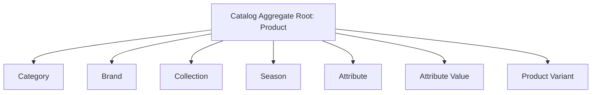
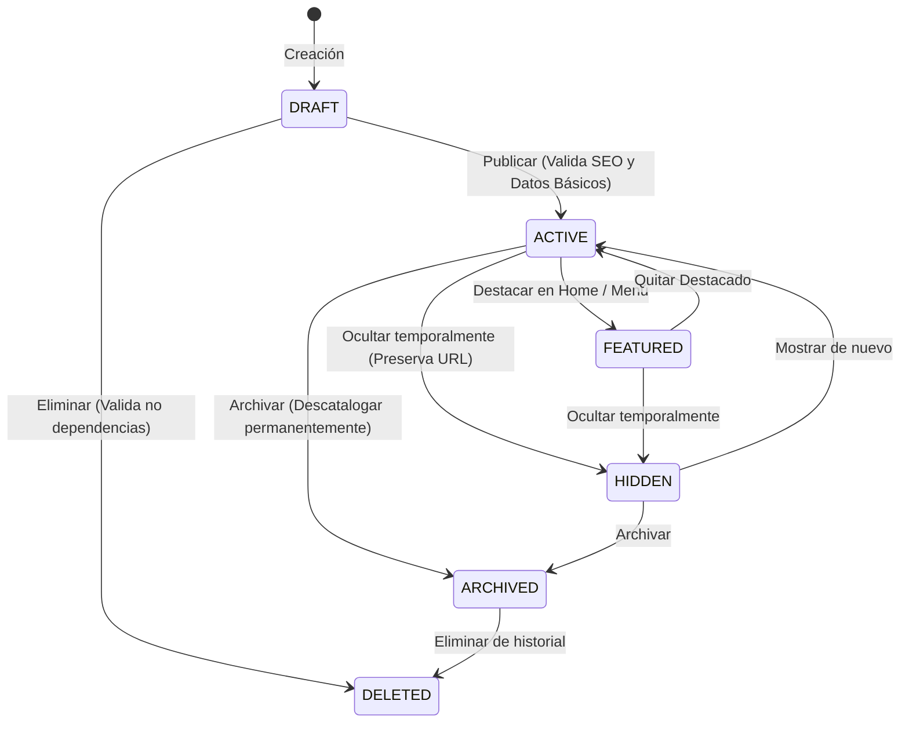
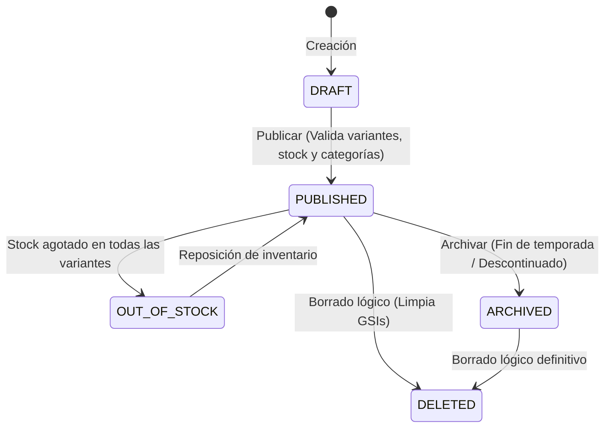

# ARCHITECTURE DECISION RECORD (ADR-003)
## ENTITY CATALOG & DOMAIN MODEL (CATALOG AGGREGATE)

**Estado:** APROBADO  
**Contexto:** Negocio y Comportamiento del Dominio  
**Arquitecto:** Principal Solutions Architect (Especialista en DDD, AWS & Serverless)  
**Versión:** 1.0.0  

---

## 1. INTRODUCCIÓN Y CONTEXTO DEL AGREGADO

En plataformas de comercio electrónico enterprise, modelar el catálogo de productos únicamente como registros de base de datos anémicos (CRUD simple) genera de forma inevitable acoplamientos rígidos, fugas de lógica de negocio en capas superiores (Lambdas) e inconsistencias graves en el estado de los datos.

Para solucionar esto, aplicamos los principios de **Domain-Driven Design (DDD)**. Agrupamos las entidades del catálogo dentro del **Catalog Aggregate** (Agregado de Catálogo). 

### Reglas de consistencia del Agregado
1. **Product** actúa como la raíz de agregado secundaria para las variantes, pero en términos taxonómicos, **Category** gobierna la navegación y estructuración de todo el sistema.
2. Todas las entidades contenidas dentro del agregado deben validar sus **Invariantes** de negocio antes de persistir cualquier cambio de estado.
3. El estado físico de DynamoDB solo puede modificarse como consecuencia directa de la ejecución exitosa de un **Caso de Uso de Dominio**.

---

## 2. CATEGORY DOMAIN MODEL (Modelo de Dominio de Categorías)

### Responsabilidad y Objetivo
Organizar el árbol taxonómico de navegación mediante una estructura de jerarquía infinita auto-referenciada, garantizando consultas inmediatas y consistencia estricta en las relaciones de árbol (evitando ciclos infinitos y nodos huérfanos).

---

### Invariantes y Reglas de Negocio Estrictas

1. **Slug URL Único**: No pueden existir dos categorías (activas o inactivas) con el mismo slug en el storefront. El slug debe ser URL-safe y formateado en minúsculas.
2. **Ciclo-Cero (Self-Parenting Block)**: Una categoría no puede tenerse a sí misma como padre (`parentId !== id`).
3. **Prevención de Ciclos en Árbol**: El `parentId` asignado a una categoría no puede ser uno de sus propios nodos descendientes en el árbol. La ruta materializada (`path`) del nodo padre no puede contener el ID de la categoría que se está editando o reubicando.
4. **Bloqueo de Eliminación por Dependencias**:
   - No puede eliminarse de forma lógica una categoría si posee **Categorías Hijas activas** (status `ACTIVE` o `FEATURED`).
   - No puede eliminarse si posee **Productos activos asociados** directamente.
5. **Configuración de Presentación y SEO**:
   - Para transicionar a `ACTIVE`, la categoría debe poseer metadatos SEO mínimos (`seoTitle` y `seoDescription` no nulos).
   - Puede poseer banners publicitarios opcionales, iconos de menú y traducciones a múltiples idiomas.

---

### Ciclo de Vida y Máquina de Estados (Category Lifecycle)

La categoría transiciona a través de estados específicos que gobiernan su visibilidad en el storefront y su capacidad de edición en el panel de administración.

#### Matriz de Transición de Estados
| Estado Origen | Estado Destino | Reglas de Validación Requeridas |
| :--- | :--- | :--- |
| `DRAFT` | `ACTIVE` | Requiere que el `name`, `slug` y metadatos SEO mínimos estén definidos. |
| `ACTIVE` | `FEATURED` | Requiere que la categoría tenga al menos una imagen promocional/banner configurada. |
| `Cualquiera (excepto DELETED)` | `HIDDEN` | Oculta la categoría y sus productos asociados del árbol de navegación pública, pero mantiene el endpoint de slug activo para evitar errores 404 en rastreadores SEO. |
| `ACTIVE \| HIDDEN` | `ARCHIVED` | Desactiva la URL. Cambia el estado de todas las categorías hijas a `ARCHIVED`. |
| `ARCHIVED \| DRAFT` | `DELETED` | **Soft Delete**. Solo permitido si no existen categorías hijas activas ni productos asociados en estado `PUBLISHED`. Se limpian las llaves de los GSIs. |

---

### Casos de Uso y Comportamiento del Dominio
- `CreateCategory`: Inicializa la categoría en estado `DRAFT`. Genera el KSUID de categoría con prefijo `cat_`.
- `PublishCategory`: Valida invariantes y cambia el estado a `ACTIVE`.
- `UpdateCategoryHierarchy`: Cambia el `parentId` de la categoría. Valida que no se cree un bucle cíclico analizando el `path` materializado del nuevo padre. Regenera recursivamente el `path` de todas las categorías descendientes.
- `SoftDeleteCategory`: Valida dependencias de productos e hijos. Aplica el borrado lógico y remueve los índices para evitar lecturas en GSIs de navegación.

---

### Mapeo de Persistencia e Índices
- **PK**: `CATEGORY#<id>`
- **SK**: `METADATA`
- **GSI1PK**: `SLUG#<slug>`
- **GSI1SK**: `METADATA` (GSI1 permite verificar la unicidad del slug de forma inmediata).
- **GSI2PK**: `PARENT#<parentId>`
- **GSI2SK**: `NAME#<name.toLowerCase()>` (Resuelve listados jerárquicos ordenados alfabéticamente).

---

## 3. PRODUCT & VARIANT DOMAIN MODEL (Productos y Variantes)

### Responsabilidad y Objetivo
Representar el núcleo comercial de venta del catálogo. El **Product** actúa como la raíz de este sub-dominio, centralizando las reglas de marca, características globales y opciones de variación, mientras que el **ProductVariant** representa el SKU físico vendible.

---

### Invariantes y Reglas de Negocio Estrictas

1. **Unicidad de SKU y EAN**:
   - Cada variante debe tener un código SKU (`sku`) único a nivel global.
   - Si se especifica el código de barras EAN (`ean`), este debe ser único globalmente.
2. **Consistencia de Precios**:
   - El precio de venta (`price`) de una variante debe ser estrictamente mayor a cero.
   - El precio de comparación (`compareAtPrice`), si existe, debe ser estrictamente mayor al precio de venta (`compareAtPrice > price`), garantizando coherencia en la visualización de rebajas o descuentos.
3. **Consistencia del Árbol de Variaciones**:
   - Un producto configurado como **Simple** solo posee una variante por defecto (cuyo ID de variante coincide o deriva del ID de producto).
   - Un producto configurado como **Variable** debe poseer al menos una variante con un mapa de atributos (`attributes`) que corresponda a las opciones globales del producto (ej: `{ talla: "40", color: "Rojo" }`).
   - No pueden existir dos variantes asociadas al mismo producto con la misma combinación exacta de atributos clave-valor.
4. **Bloqueo de Publicación**:
   - Un producto no puede pasar a `PUBLISHED` si no tiene asignada al menos una variante activa con stock disponible o políticas de preventa habilitadas.
   - Requiere obligatoriamente al menos una categoría asociada.

---

### Ciclo de Vida y Máquina de Estados (Product Lifecycle)

#### Matriz de Transición de Estados
| Estado Origen | Estado Destino | Reglas de Validación Requeridas |
| :--- | :--- | :--- |
| `DRAFT` | `PUBLISHED` | Requiere: Marca válida, al menos 1 categoría asociada, al menos 1 variante activa, y precio base configurado. |
| `PUBLISHED` | `OUT_OF_STOCK` | Transición automática del sistema cuando la suma de `stockAvailable` de todas sus variantes en todas las bodegas es igual a `0`, y no se permite la venta sin stock. |
| `PUBLISHED \| ARCHIVED` | `DELETED` | **Soft Delete**. Marca el producto y sus variantes como eliminados. Se limpian los índices en GSIs de catálogo. |

---

### Relaciones del Agregado de Catálogo
- **Product - Brand**: Relación N:1. El producto debe apuntar a una marca activa.
- **Product - Category**: Relación N:M. Un producto puede pertenecer a múltiples categorías. Se modela en base de datos mediante un ítem de enlace `PRODUCT#<productId>` y `SK: CATEGORY#<categoryId>`.
- **Product - Variant**: Relación de composición 1:N. La existencia de la variante depende enteramente de la existencia del producto.

---

### Casos de Uso del Catálogo
- `CreateProduct`: Registra el producto raíz en estado `DRAFT`.
- `AddProductVariant`: Agrega un nuevo SKU físico a un producto variable, verificando que no colisionen los atributos o SKUs.
- `UpdateVariantPricing`: Actualiza los precios de la variante, garantizando la consistencia de rebajas (`compareAtPrice > price`).
- `AssignCategories`: Vincula el producto a categorías válidas, actualizando los índices de búsqueda.
- `SoftDeleteProduct`: Desactiva el producto, sus variantes y sus relaciones de catálogo.

---

### Mapeo de Persistencia (DynamoDB Single Table)
- **PK**: `PRODUCT#<productId>`
- **SK**: `METADATA`
- **GSI1PK**: `SLUG#<slug>`
- **GSI1SK**: `METADATA` (Unicidad de URL de producto).
- **GSI2PK**: `CATEGORY#<categoryId>`
- **GSI2SK**: `PRODUCT#<status>#<createdAt>` (Para listar cronológicamente productos activos de una categoría).
- **GSI3PK**: `BRAND#<brandId>`
- **GSI3SK**: `PRODUCT#<status>#<createdAt>` (Para listar productos de una marca).

---

## 4. BRAND, COLLECTION, SEASON & ATTRIBUTES (Entidades de Soporte)

### Brand (Marca)
- **Responsabilidad**: Identificación del fabricante o firma del producto.
- **Invariante**: Nombre único, slug único.
- **Access Patterns**:
  - `AP-BRAND-01`: Obtener marca por ID.
  - `AP-BRAND-02`: Obtener marca por Slug.

### Collection (Colección / Agrupación Comercial)
- **Responsabilidad**: Agrupar productos de forma transversal al árbol taxonómico (ej: "Colección Cyber Monday", "Colección Primavera").
- **Invariante**: Fecha de inicio y fin de vigencia opcional. Si está fuera de vigencia, los productos asociados no se muestran en la colección pública.
- **Access Patterns**:
  - `AP-COLL-01`: Obtener colección por ID.
  - `AP-COLL-02`: Listar productos activos de una colección específica.

### Attribute & Attribute Value (Especificaciones y Filtros)
- **Responsabilidad**: Definir las propiedades dinámicas de los productos para la ficha técnica y la navegación facetada (filtros).
- **Invariantes**:
  - Un atributo (ej: `"Color"`) tiene múltiples valores (ej: `"Rojo"`, `"Azul"`).
  - Los valores del atributo deben respetar el tipo de dato definido por el atributo (Texto, Número, Color Hex, etc.).
- **Access Patterns**:
  - `AP-ATTR-01`: Listar atributos globales del catálogo para filtros de búsqueda.

---

## 5. EVENTOS DE DOMINIO PUBLICADOS POR EL AGREGADO

Cualquier cambio de estado validado dentro del agregado gatilla la publicación de **Domain Events** inmutables a través de Amazon EventBridge para notificar a otros bounded contexts (como Inventario, Logística, Marketing y CRM).

| Evento | Origen | Payload Clave | Consumidores de Dominio |
| :--- | :--- | :--- | :--- |
| `PRODUCT.PUBLISHED` | Producto | `productId`, `categories`, `skus`, `price` | OpenSearch Indexer (Actualiza catálogo de búsqueda), Marketing Campaigns |
| `PRODUCT.DELETED` | Producto | `productId`, `skus` | Inventory Cleanups, Cache Invalidation, OpenSearch Indexer (Remover de índice) |
| `VARIANT.PRICE_CHANGED` | Variante | `productId`, `variantId`, `oldPrice`, `newPrice` | Smart Cart Service (Notificar bajadas de precio en carritos guardados) |
| `CATEGORY.HIERARCHY_CHANGED`| Categoría | `categoryId`, `oldParentId`, `newParentId`, `newPath` | SEO Redirection Engine, OpenSearch Indexer |
