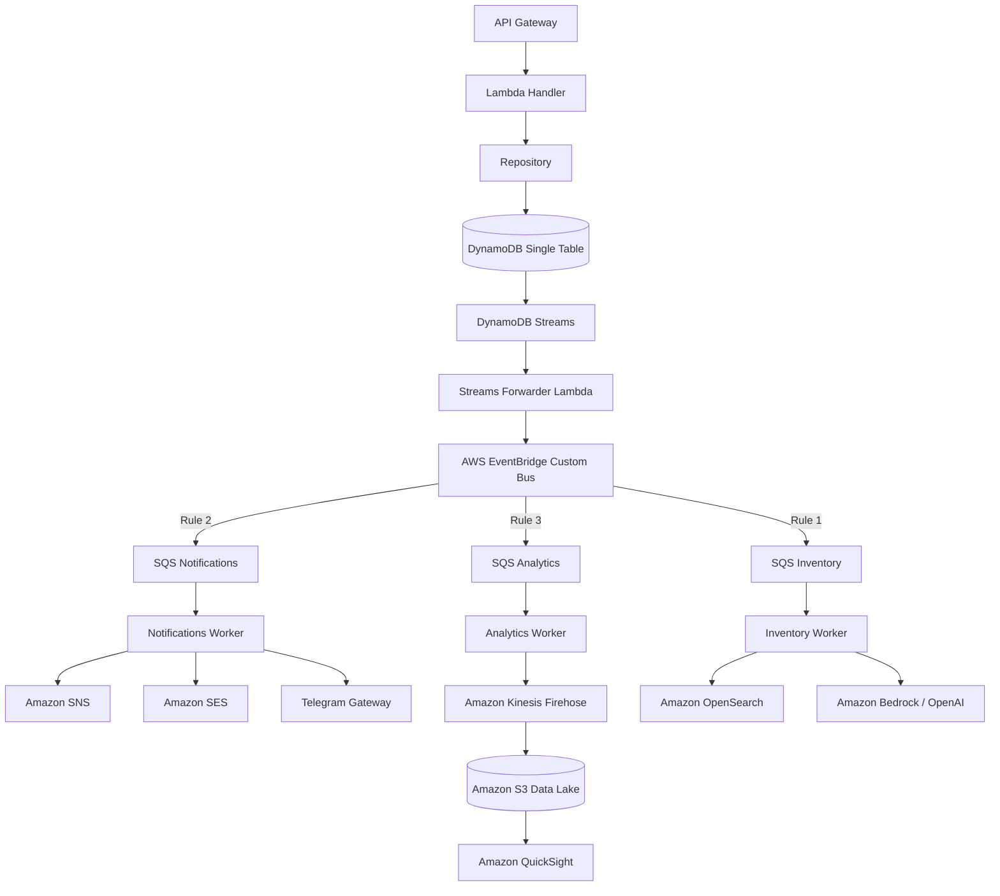

# ARCHITECTURE DECISION RECORD (ADR-004)
## EVENT-DRIVEN ARCHITECTURE & EVENT CATALOG

**Estado:** APROBADO  
**Contexto:** Arquitectura de Integración e Ingeniería de Eventos  
**Arquitecto:** Principal Solutions Architect (Especialista en EDA, AWS EventBridge & DDD)  
**Versión:** 1.0.0  

---

## CAPÍTULO 1: Fundamentos de Event-Driven Architecture (EDA)

Para escalar una plataforma de comercio electrónico a nivel Enterprise que procese millones de transacciones diarias, es insostenible depender de llamadas síncronas HTTP (REST/gRPC) entre microservicios. Las interacciones síncronas propagan fallos en cascada, aumentan la latencia total y acoplan rígidamente los límites del dominio.

Adoptamos **Event-Driven Architecture (EDA)** respaldada por los siguientes pilares de diseño:

### 1. Domain Events (Eventos de Dominio)
- **Definición**: Expresan un cambio de estado relevante que ya ocurrió **dentro** de un mismo Bounded Context.
- **Propósito**: Comunicar cambios entre entidades pertenecientes al mismo agregado (o agregados adyacentes) para mantener la consistencia interna. Su semántica está estrechamente ligada al lenguaje ubicuo (ej: `CategoryDrafted`, `VariantStockReserved`).

### 2. Integration Events (Eventos de Integración)
- **Definición**: Mensajes de alto nivel destinados a ser consumidos por **otros** Bounded Contexts o sistemas externos de la organización (ej: Facturación, Envíos, CRM).
- **Propósito**: Propagar estados globales desprovistos de detalles internos de persistencia para evitar que los consumidores se acoplen a la estructura de datos privada del productor.

### 3. Eventual Consistency (Consistencia Eventual)
- **Definición**: Los datos no se actualizan instantáneamente de forma transaccional en todo el sistema global. En su lugar, el sistema converge de forma asíncrona hacia un estado consistente.
- **Justificación**: Cambiamos la consistencia fuerte (que bloquea recursos físicos) por alta disponibilidad y bajísima latencia. El proceso de pago o reserva de stock se confirma síncronamente en el core, pero la actualización del buscador (OpenSearch) o del CRM ocurre milisegundos después de forma eventual.

### 4. Idempotencia y Procesamiento At-Least-Once
- **Definición**: Garantía de que procesar el mismo evento múltiples veces produce el mismo resultado que procesarlo una sola vez.
- **Estrategia**: EventBridge y SQS garantizan entrega *at-least-once* (al menos una vez), lo que implica que pueden ocurrir duplicados en la red. Todo consumidor en CommerceOS debe implementar validación de idempotencia usando el `eventId` único del evento como llave en una tabla de control rápida (ej: Redis o DynamoDB con TTL de 7 días).

### 5. Trade-offs (Compromisos del Diseño)
- **Ventajas**: Desacoplamiento total de despliegue, escalabilidad elástica independiente, tolerancia a fallos extrema (si un consumidor cae, los mensajes esperan en su cola SQS).
- **Desafíos**: Complejidad en la depuración distributiva, gestión de carrera en eventos concurrentes y monitoreo de latencia en la entrega eventual.

---

## CAPÍTULO 2: Arquitectura General del Flujo de Eventos

Diseñamos una topología asíncrona serverless elástica, libre de servidores físicos y de bajo acoplamiento:



### Responsabilidades por Capa:
1. **API Gateway**: Punto de entrada REST síncrono. Resuelve CORS, límites de tasa y enrutamiento rápido.
2. **Lambda Handler**: Ejecuta la lógica del caso de uso. Valida los invariantes del agregado.
3. **Repository**: Escribe el cambio en la Single Table de DynamoDB de forma transaccional.
4. **DynamoDB Streams**: Captura de Datos de Cambio (CDC) nativa en orden cronológico estricto por llave de partición.
5. **Streams Forwarder Lambda**: Lee los streams de DynamoDB de forma asíncrona, extrae la imagen del registro modificado, construye el evento bajo el estándar corporativo y lo publica en Amazon EventBridge. Esto actúa como el patrón **Transactional Outbox**, garantizando que si la base de datos se escribe con éxito, el evento se publicará sí o sí.
6. **AWS EventBridge (Custom Event Bus)**: El core del sistema de eventos. Recibe los mensajes y los enruta basándose en reglas de patrones JSON a múltiples consumidores.
7. **SQS (Simple Queue Service)**: Actúa como búfer de protección delante de cada consumidor. Si el consumidor falla o se ralentiza, SQS retiene el mensaje (con reintentos automáticos y Dead Letter Queues - DLQ).
8. **SNS (Simple Notification Service)**: Distribución fan-out masiva para notificaciones push en tiempo real.

---

## CAPÍTULO 3: Convenciones del Mensaje (Envelope Schema)

Para garantizar la interoperabilidad de todos los módulos presentes y futuros, todo evento publicado en el Bus de EventBridge debe respetar de forma obligatoria la siguiente estructura base de metadatos (Envelope):

```json
{
  "eventId": "evt_3GYEZpaYnluMjcJvUaIT903wF5M",
  "eventType": "ORDER.PAID",
  "eventVersion": 1,
  "source": "commerceos.ordering",
  "traceId": "ecf3e9c2-61be-44ca-9aef-16b19f6647df",
  "correlationId": "60b649fa-1c88-4a51-b3f5-30ddf533ce45",
  "actor": "usr_3GYEZpaYnluMjcJvUaIT9",
  "timestamp": "2026-07-15T18:29:20.433Z",
  "payload": {
    "orderId": "ord_93HJNBPEJJUP7OIBF2",
    "amount": 125.50
  }
}
```

### Campos Obligatorios y Semántica:
- **`eventId`**: ID único del evento generado usando KSUID con prefijo `evt_` para de-duplicación.
- **`eventType`**: Nombre del evento estructurado en formato `[ENTIDAD].[VERBO_EN_PASADO]`.
- **`eventVersion`**: Entero secuencial que indica la versión del esquema del payload.
- **`source`**: Identificador del microservicio o Bounded Context emisor (ej: `commerceos.catalog`).
- **`traceId`**: Trace ID generado en el API Gateway y propagado en todas las llamadas internas para tracing distribuido.
- **`correlationId`**: ID de correlación único de la sesión o transacción del usuario que gatilló la cadena de eventos.
- **`actor`**: ID del usuario, sistema o bot de IA que ejecutó la acción original.
- **`timestamp`**: Fecha y hora precisa en que ocurrió el evento (ISO 8601 UTC).
- **`payload`**: Objeto JSON que contiene los datos específicos del evento.

---

## CAPÍTULO 4: Catálogo Completo de Eventos de CommerceOS

### 1. Dominio: Catalog (Catálogo)
- **`CATALOG.CATEGORY_CREATED`**
  - *Descripción*: Emitido al crear una nueva categoría en estado borrador o activo.
  - *Publica*: `Catalog Service`
  - *Consumen*: `OpenSearch Indexer` (Prioridad: Media)
  - *Payload*: `{ "categoryId": "cat_123", "name": "Ropa", "slug": "ropa" }`
- **`CATALOG.PRODUCT_PUBLISHED`**
  - *Descripción*: Emitido cuando un producto se publica con éxito y está listo para venta.
  - *Publica*: `Catalog Service`
  - *Consumen*: `Search Indexer`, `Recommendation Engine` (Prioridad: Alta)
  - *Payload*: `{ "productId": "prd_999", "name": "Zapato", "categories": ["cat_123"], "basePrice": 99.00 }`

### 2. Dominio: Commerce (Transaccional / Ventas)
- **`COMMERCE.ORDER_CREATED`**
  - *Descripción*: Un cliente inicia una orden de compra en estado pendiente de pago.
  - *Publica*: `Checkout Service`
  - *Consumen*: `Inventory Service` (para reserva temporal de stock), `Orchestrator` (Prioridad: Alta)
  - *Payload*: `{ "orderId": "ord_888", "customerId": "usr_111", "items": [{ "sku": "SKU-99", "qty": 1 }], "total": 99.00 }`
- **`COMMERCE.ORDER_PAID`**
  - *Descripción*: Confirmación exitosa del cobro de la orden.
  - *Publica*: `Payment Processor`
  - *Consumen*: `Inventory` (confirmar reserva), `CRM`, `Billing`, `Logistics` (Prioridad: Alta)
  - *Payload*: `{ "orderId": "ord_888", "paymentId": "pay_555", "amount": 99.00 }`

### 3. Dominio: Inventory (Logística / Stock)
- **`INVENTORY.STOCK_RESERVED`**
  - *Descripción*: Stock temporal o definitivo reservado en bodega para una variante.
  - *Publica*: `Inventory Service`
  - *Consumen*: `Catalog Service` (para actualizar disponibilidad) (Prioridad: Alta)
- **`INVENTORY.LOW_STOCK_DETECTED`**
  - *Descripción*: Variante cae por debajo del stock de seguridad configurado.
  - *Publica*: `Inventory Service`
  - *Consumen*: `Procurement Bot (AI)`, `Dashboard Admin` (Prioridad: Media)

### 4. Dominio: Customer (Clientes)
- **`CUSTOMER.REGISTERED`**
  - *Descripción*: Registro exitoso de un nuevo cliente.
  - *Publica*: `Identity Service`
  - *Consumen*: `Notification Engine` (Email de bienvenida), `CRM` (Prioridad: Media)
- **`CUSTOMER.LOYALTY_TIER_CHANGED`**
  - *Descripción*: Cliente sube de nivel de lealtad (Plata, Oro, Platino) por acumulación de compras.
  - *Publica*: `Loyalty Engine`
  - *Consumen*: `Marketing Campaign Engine` (Enviar cupón de regalo) (Prioridad: Media)

### 5. Dominio: CMS (Contenidos y Experiencia)
- **`CMS.PAGE_PUBLISHED`**
  - *Descripción*: Se publica o actualiza una página o landing page de la tienda.
  - *Publica*: `CMS Engine`
  - *Consumen*: `CDN Invalidator` (Prioridad: Baja)

### 6. Dominio: Marketing (Promociones / Fidelización)
- **`MARKETING.COUPON_REDEEMED`**
  - *Descripción*: Uso exitoso de un cupón de descuento en una compra.
  - *Publica*: `Checkout Service`
  - *Consumen*: `Marketing Engine` (Actualizar métricas de campaña) (Prioridad: Baja)

### 7. Dominio: Support (Soporte al Cliente)
- **`SUPPORT.TICKET_CREATED`**
  - *Descripción*: Apertura de un ticket de soporte técnico o chat de asistencia.
  - *Publica*: `Support Service`
  - *Consumen*: `Support AI Agent` (Genera respuesta automática o asigna agente) (Prioridad: Media)

### 8. Dominio: Identity (Seguridad / Sesión)
- **`IDENTITY.SUSPICIOUS_LOGIN_BLOCKED`**
  - *Descripción*: Intento de inicio de sesión bloqueado por geolocalización inusual.
  - *Publica*: `Security Guard (Cognito Custom Hook)`
  - *Consumen*: `Security Incident Room` (Telegram Alert), `Customer Notification` (Prioridad: Alta)

### 9. Dominio: Analytics (Métricas en Tiempo Real)
- **`ANALYTICS.PAGE_VIEWED`**
  - *Descripción*: Cliente visita la ficha de un producto o categoría.
  - *Publica*: `Storefront BFF`
  - *Consumen*: `Analytics Data Lake`, `Recommendation Engine` (Prioridad: Baja)

### 10. Dominio: AI (Modelos Predictivos y Agentes)
- **`AI.SEARCH_ABANDONED`**
  - *Descripción*: El cliente busca un término, ve los resultados y sale de la web sin interactuar.
  - *Publica*: `Search Service`
  - *Consumen*: `AI Merchant` (Ajustar sugerencias de OpenSearch) (Prioridad: Baja)

### 11. Dominio: Media (Gestión de Archivos / S3)
- **`MEDIA.IMAGE_UPLOADED`**
  - *Descripción*: Se sube una imagen original a un bucket de S3.
  - *Publica*: `S3 Storage Service`
  - *Consumen*: `Media Optimization Worker` (Redimensiona y optimiza a WebP) (Prioridad: Baja)

### 12. Dominio: Configuration (Parámetros Globales)
- **`CONFIGURATION.FEATURE_FLAG_TOGGLED`**
  - *Descripción*: Habilitación o deshabilitación en caliente de una función mediante Panel de Control.
  - *Publica*: `Config Service`
  - *Consumen*: `Lambda Cache Invalidator` (Prioridad: Alta)

---

## CAPÍTULO 5: Topología de Consumidores (Fan-out de Eventos Clave)

Para ilustrar el desacoplamiento, tomemos el evento **`COMMERCE.ORDER_PAID`**. Un único evento es ruteado por EventBridge en paralelo a múltiples colas SQS independientes para que cada consumidor actúe de forma aislada:

```
COMMERCE.ORDER_PAID
│
├──> [SQS Inventory] -------> Actualiza stock físico final / Libera reservas
├──> [SQS Notifications] ---> Envía confirmación por Email (SES) y SMS (SNS)
├──> [SQS Analytics] -------> Registra la conversión (QuickSight Data Lake)
├──> [SQS CRM] -------------> Actualiza perfil del cliente y acumula puntos de lealtad
├──> [SQS ERP] -------------> Envía orden para facturación contable y emisión de recibo fiscal
├──> [SQS Logistics] -------> Crea orden de despacho con la transportadora asociada
└──> [SQS Accounting] ------> Registra el asiento contable de ingreso de dinero
```

---

## CAPÍTULO 6: Topología de Automatizaciones y Orquestación asíncrona

### Automatización 1: Flujo de Carrito Abandonado (`COMMERCE.ORDER_CREATED` sin pago)
1. **Punto de Partida**: Se publica `COMMERCE.ORDER_CREATED`.
2. **Orquestación**: Un estado en **AWS Step Functions** se suscribe al evento y arranca una espera de 30 minutos.
3. **Validación**: Transcurridos los 30 minutos, la máquina de estados lee DynamoDB para verificar el estado de la orden.
4. **Rama No Pagó**: Si el estado sigue siendo `PENDING`:
   - Envía correo persuasivo (SES) ("¿Olvidaste algo? Tu carrito te espera").
   - Publica alerta en canal de soporte de Telegram de carritos caídos.
   - Genera dinámicamente un cupón de descuento del 10% con validez de 24 horas y lo envía al cliente.

### Automatización 2: Reabastecimiento Automatizado (`INVENTORY.LOW_STOCK_DETECTED`)
1. **Punto de Partida**: Se publica `INVENTORY.LOW_STOCK_DETECTED`.
2. **Workers**:
   - El **Dashboard** marca el producto con etiqueta "Stock Crítico".
   - El **Procurement Bot (AI)** en Bedrock procesa la velocidad de venta histórica del SKU, estima los días de cobertura y redacta automáticamente una orden de compra de reposición dirigida al proveedor histórico.
   - Envía borrador de orden de compra al equipo de Compras vía Telegram para su aprobación con un botón interactivo.

---

## CAPÍTULO 7: Integraciones y Webhooks Externos

Para integrarnos con servicios externos e interactuar con proveedores y transportadoras, implementamos el siguiente flujo de procesamiento de eventos:

```
[EventBridge Engine] 
       │
       ├──> [Google/Meta Analytics worker] ──> Envia conversiones vía Conversion API (CAPI)
       ├──> [Logistics Gateway worker] ──────> Llama a la API de DHL/FedEx para guías
       ├──> [ERP Ingestion worker] ──────────> Sincroniza stock y ventas con SAP/Oracle
       └──> [Bedrock AI worker] ─────────────> Genera recomendaciones y analiza reseñas
```

- **Meta / Google Conversion API**: El worker de analíticas toma los eventos `ORDER_PAID` y `PAGE_VIEWED` desde SQS y realiza peticiones síncronas HTTPS directas a los servidores de Meta y Google con los tokens del pixel para el tracking 100% server-side (GDPR compliant).
- **Transportadoras**: Al confirmarse `ORDER_PAID`, el worker de logística toma la dirección del cliente, llama al API de la transportadora para cotizar y emitir la guía de envío, y guarda la URL de tracking en DynamoDB.

---

## CAPÍTULO 8: Observabilidad de Eventos y Trazabilidad Forense

Para asegurar que un flujo asíncrono no se transforme en una "caja negra", definimos tres mecanismos de monitoreo estricto:

1. **Tracing Distribuido con AWS X-Ray**:
   - Cada llamada síncrona en el API Gateway genera un `TraceId` que es propagado por la Lambda en las cabeceras HTTP de llamadas secundarias, en los metadatos de los ítems de DynamoDB, y en el metadato base del evento en EventBridge.
   - X-Ray mapa visualmente el tiempo de procesamiento de cada Lambda, los tiempos de espera en las colas SQS, y el tiempo de respuesta de las APIs de terceros.
2. **Correlation ID**:
   - Identificador único que asocia múltiples transacciones o flujos de trabajo diferentes iniciados por el mismo usuario (ej: de clic en banner -> registro -> carrito -> pago). Este ID se mantiene inmutable en toda la traza.
3. **Métricas y Alertas CloudWatch**:
   - Alarma de cola SQS sobrecargada: Alerta si el indicador `ApproximateNumberOfMessagesVisible` supera el umbral durante más de 3 minutos.
   - Alarma de mensajes en Dead Letter Queue (DLQ): Alerta inmediata si un mensaje cae en la DLQ de algún consumidor, indicando un fallo catastrófico en el procesamiento de eventos.

---

## CAPÍTULO 9: Evolución del Esquema y Versionado de Eventos

Los requisitos de negocio cambian, y el esquema de los eventos evolucionará. Para evitar romper los consumidores en producción, aplicamos las siguientes directrices de versionado:

### 1. Cambios No-Rupturistas (Non-Breaking Changes)
- Añadir nuevos campos opcionales al payload.
- **Regla**: Los consumidores deben ignorar cualquier campo desconocido que no esté en su esquema (patrón de robustez de Postel).

### 2. Cambios Rupturistas (Breaking Changes)
- Renombrar campos obligatorios, cambiar tipos de datos (ej: de String a Array) o remover propiedades.
- **Estrategia: Event Versioning & Dual Writing**:
  - El productor incrementa el `eventVersion` a `2`.
  - El productor publica **ambas versiones** del evento de forma transitoria en EventBridge (escribe versión 1 y versión 2 simultáneamente).
  - Los consumidores migran a la versión 2 a su propio ritmo.
  - Una vez que las métricas de CloudWatch confirman que no hay más tráfico consumiendo la versión 1, el productor deja de emitir el evento versión 1.
- **Upcaster en Consumidor**: Para evitar dual writing pesado, los consumidores pueden implementar una capa intermedia (Upcaster) que recibe la versión 1 y la transforma al esquema de la versión 2 en memoria antes de pasarlo a la lógica del dominio.

---

## CAPÍTULO 10: Checklist de Calidad para Publicar Nuevos Eventos

Antes de que un desarrollador o módulo pueda dar de alta y publicar un nuevo evento en el bus corporativo de EventBridge, el esquema y diseño deben aprobar el siguiente checklist:

- [ ] **Nombre de Evento en Pasado**: El `eventType` utiliza el formato `[ENTIDAD].[VERBO_EN_PASADO]` en mayúsculas (ej: `PRODUCT.ARCHIVED`).
- [ ] **Esquema de Metadatos Obligatorio**: El evento incluye `eventId`, `eventType`, `eventVersion`, `source`, `traceId`, `correlationId`, `actor` y `timestamp` en su raíz.
- [ ] **Independencia de Persistencia**: El payload no es un clon de la fila de la base de datos; solo contiene los atributos clave necesarios para la integración de dominios.
- [ ] **Definición de Dead Letter Queue (DLQ)**: Las reglas de EventBridge y las colas SQS asociadas tienen configuradas DLQ para desvíos de fallos.
- [ ] **Garantía de Idempotencia**: El microservicio consumidor implementa almacenamiento de IDs de eventos procesados para evitar re-ejecuciones.
- [ ] **Documentación en el Catálogo**: El evento ha sido añadido a este registro maestro (ADR-004) detallando publicadores, consumidores y cargas de ejemplo.
- [ ] **Políticas de Versionado**: Si es un cambio sobre un evento existente, se ha analizado el impacto y se ha aplicado la estrategia de Upcaster o Dual Writing.
