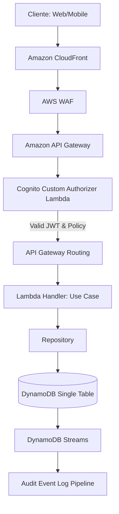

# ARCHITECTURE DECISION RECORD (ADR-005)
## SECURITY, IDENTITY & AUTHORIZATION FRAMEWORK

**Estado:** APROBADO  
**Contexto:** Arquitectura de Seguridad, Identidad y Autorización a Nivel Enterprise  
**Arquitecto:** Principal Security Architect (Especialista en AWS Security, Cognito & Zero Trust)  
**Versión:** 1.0.0  

---

## CAPÍTULO 1: Principios de Seguridad

Diseñamos una arquitectura guiada por principios estrictos alineados con estándares internacionales (NIST SP 800-207, ISO 27001 y OWASP):

1. **Zero Trust (Confianza Cero)**: Asumimos que la red es hostil por defecto. No existen perímetros "seguros" de confianza (como una VPC privada). Cada solicitud, interna o externa, debe validarse, autenticarse, autorizarse y cifrarse síncronamente antes de procesarse.
2. **Least Privilege (Mínimo Privilegio)**: Los actores (usuarios, microservicios y roles de Lambda) operan únicamente con el conjunto mínimo de permisos necesarios para cumplir su función específica en un tiempo determinado.
3. **Defense in Depth (Defensa en Capas)**: Implementamos controles de seguridad redundantes a lo largo del flujo de ejecución (Red, Transporte, API, Autorización, Aplicación y Persistencia). Si una capa falla, las capas adyacentes contienen el ataque.
4. **Separation of Duties (Separación de Funciones)**: Dividimos las operaciones críticas en múltiples roles administrativos para prevenir fraudes e incidentes involuntarios (ej. el rol que autoriza reembolsos no puede crear facturas).
5. **Secure by Default (Seguridad por Defecto)**: Todo puerto, API, bucket de S3 o recurso de base de datos se despliega cerrado por defecto. Las excepciones se abren de forma explícita y documentada.
6. **Principle of Explicit Authorization (Autorización Explícita)**: Ningún caso de uso ejecuta lógica si no ha evaluado previamente un token de autorización verificado y una política activa.
7. **OWASP Top 10 & Threat Modeling**: Evaluamos activamente los riesgos de inyección, control de acceso roto, fallos criptográficos y deserializaciones inseguras para diseñar defensas proactivas en el código y el enrutamiento.

---

## CAPÍTULO 2: Arquitectura General del Flujo de Peticiones

Diseñamos una canalización de extremo a extremo que protege cada capa del ciclo de vida de la solicitud:



### Responsabilidades por Capa:
1. **CloudFront**: Terminación SSL/TLS 1.3 en el borde global. Filtra peticiones HTTP malformadas y reduce latencia mediante almacenamiento en caché.
2. **AWS WAF (Web Application Firewall)**: Mitiga denegación de servicio (DDoS), inspecciona inyecciones SQL/XSS, restringe IPs sospechosas y aplica reglas de reputación de IP.
3. **API Gateway**: Expone rutas REST, gestiona el Rate Limiting (límite de peticiones) y delegación de la autorización al Custom Authorizer.
4. **Cognito Custom Authorizer (Lambda)**: Valida la firma del JWT (firma criptográfica JWKS), extrae los *claims* de identidad, consulta las políticas de permisos correspondientes y devuelve una política IAM de API Gateway en caché.
5. **Lambda Handler (Capa de Aplicación)**: Contiene las reglas del caso de uso. Ejecuta validaciones de dominio.
6. **Repository**: Escribe el cambio en DynamoDB de forma segura, garantizando el aislamiento de datos (por ejemplo, Tenants/Organizaciones).
7. **DynamoDB Single Table**: Persistencia cifrada en reposo con llaves administradas por AWS KMS (`aws/dynamodb`).
8. **DynamoDB Streams / Audit Pipeline**: Captura de datos en orden cronológico para alimentar el registro de auditoría inmutable de forma asíncrona.

---

## CAPÍTULO 3: Gestión de Identidad (AWS Cognito)

Utilizamos **AWS Cognito** como proveedor de identidad (IdP) centralizado, dividiendo las responsabilidades en dos infraestructuras lógicas:

### 1. User Pools (Autenticación y Registro)
Es el directorio de usuarios que almacena perfiles y gestiona flujos de acceso:
- **Flujos de Registro y Login**: Implementa el protocolo OAuth 2.0 / OIDC. Soporta autenticación nativa y federada.
- **Invitados (Guests)**: Gestionamos sesiones anónimas mediante tokens efímeros firmados por el backend (JWT de invitado) para evitar ensuciar el User Pool con registros falsos.
- **Recuperación de Contraseña**: Flujo automatizado de autoservicio vía correo electrónico con códigos de un solo uso firmados (OTP) de vigencia de 1 hora.
- **Verificación**: Configurado el canal de correo (SES) y SMS (SNS) para validar el correo y número de teléfono móvil de forma mandatoria tras el registro.
- **MFA (Multi-Factor Authentication)**: Configuración obligatoria (`MFA Required`) para roles administrativos y opcional para clientes, usando OTP basadas en tiempo (TOTP como Google Authenticator) y SMS de respaldo.
- **Passkeys (FIDO2/WebAuthn)**: Habilitado a través de flujos personalizados de Cognito (Custom Auth Challenges) para permitir login biométrico seguro (TouchID/FaceID) sin contraseña.
- **Social Login (Federación)**: Integración nativa vía OIDC/SAML 2.0 con **Google**, **Facebook**, **Apple** y **GitHub**, mapeando automáticamente los claims a atributos estándar del User Pool.
- **Gestión de Cuentas**:
  - **Invitación de Usuarios**: El panel administrador crea cuentas en estado `FORCE_CHANGE_PASSWORD` mediante invitación con enlace cifrado temporal por email.
  - **Desactivación de Cuentas**: Estado del usuario cambia a `Disabled`, bloqueando de inmediato la emisión de nuevos tokens sin eliminar sus datos históricos (para consistencia contable).
  - **Bloqueo Automático**: Cierre preventivo de la cuenta tras 5 intentos fallidos consecutivos de contraseña, desbloqueándose automáticamente tras 15 minutos.

### 2. Identity Pools (Autorización a Recursos AWS)
Mapea las identidades del User Pool a credenciales temporales de IAM de AWS para el frontend, permitiendo la subida directa y segura a buckets de S3 privados (por ejemplo, fotos de perfil o recibos de pago).

---

## CAPÍTULO 4: Taxonomía de Roles Enterprise

Definimos los roles de negocio autorizados en la plataforma:

| Rol | Responsabilidad Core | Restricciones Críticas |
| :--- | :--- | :--- |
| **Super Admin** | Acceso total a infraestructura, configuración global y cuentas. | Requiere MFA mandatorio y control de IP restrictivo. |
| **Admin** | Operación completa de la tienda, catálogo, CRM y finanzas. | No puede alterar variables del sistema ni asignar roles Super Admin. |
| **Content Manager** | Creación, modificación y publicación de contenido en CMS y Blog. | No tiene acceso al catálogo comercial ni a finanzas. |
| **Catalog Manager** | Gestión de categorías, productos, variantes y colecciones. | No puede ver reportes de ventas ni facturas. |
| **Sales** | Gestión de órdenes de compra, cupones y devoluciones parciales. | No puede aprobar reembolsos totales. |
| **Support** | Atención al cliente, chat en vivo y asignación de tickets. | No puede alterar datos de configuración del cliente. |
| **Warehouse** | Recepción de mercancía, picking, packing y despacho físico. | No tiene acceso a datos de tarjetas de crédito o finanzas. |
| **Marketing** | Creación de campañas, cupones y configuraciones de fidelización. | No puede publicar contenidos del core CMS. |
| **Finance** | Contabilidad contable, impuestos, facturas y aprobación de reembolsos. | No puede alterar el catálogo de productos. |
| **Customer** | Compra en tienda, gestión de su perfil, direcciones e historial. | Restringido exclusivamente a sus propios registros de datos. |
| **Guest** | Navegación, carrito de compras temporal e inicio de checkout. | No puede ver precios con descuentos corporativos ni historial. |

---

## CAPÍTULO 5: Estructura Jerárquica de Permisos

Implementamos un esquema granular de permisos con nomenclatura por componentes en formato `[DOMINIO].[ENTIDAD].[ACCIÓN]` para evitar el acoplamiento rígido de roles:

### Dominio: Catalog
- `catalog.category.create`
- `catalog.category.update`
- `catalog.category.delete`
- `catalog.product.create`
- `catalog.product.publish`
- `catalog.product.delete`

### Dominio: Order / Sales
- `order.create`
- `order.read.own`
- `order.read.all`
- `order.cancel`
- `order.refund`

### Dominio: CMS / Marketing
- `cms.page.publish`
- `cms.blog.create`
- `marketing.coupon.create`

### Dominio: Support / Analytics / Settings
- `support.ticket.assign`
- `analytics.view`
- `settings.update`

---

## CAPÍTULO 6: Diseño del Sistema RBAC (Role-Based Access Control)

El sistema **RBAC** asocia los permisos directamente a los **Roles**, y los usuarios pertenecen a uno o más roles:

```
[Usuario] ──> [Pertenece a] ──> [Grupos/Roles] ──> [Heredan de] ──> [Permisos Granulares]
```

### Reglas de Herencia y Jerarquía:
- Los roles se organizan de forma piramidal para evitar duplicidad de configuración.
- El rol `Super Admin` hereda implícitamente de todos los roles.
- El rol `Admin` hereda de `Catalog Manager`, `Sales`, `Content Manager` y `Support`.
- La herencia se resuelve en tiempo de construcción del token de autorización o evaluación de políticas.

### Delegación Temporal:
- Un administrador puede delegar un subconjunto de permisos a otro usuario mediante una política con fecha de expiración (`ExpiresAt`).
- Esta delegación se guarda en DynamoDB y el autorizador evalúa estas reglas dinámicamente en cada llamada.

---

## CAPÍTULO 7: Modelo ABAC (Attribute-Based Access Control)

Implementamos **ABAC** para resolver condiciones dinámicas complejas que RBAC no puede cubrir de forma estática:

```
[Sujeto: Rol Sales] + [Recurso: Reembolso] + [Entorno: Horario Laboral & IP Corporativa] ──> [Autorizado]
```

### Casos de Uso Core de ABAC:
1. **Aislamiento Geográfico e IP**:
   - *Regla*: El rol `Finance` solo puede ejecutar `order.refund` si la petición proviene de la red VPN corporativa (rango de IPs explícito) y en días laborables de 8:00 AM a 6:00 PM.
2. **Propiedad del Recurso (Resource Ownership)**:
   - *Regla*: Un cliente solo puede ejecutar `order.read` si el atributo `customerId` del recurso solicitado coincide con su ID de usuario (`sub` del JWT).
3. **Límites Financieros**:
   - *Regla*: Un agente de `Sales` puede ejecutar `order.refund` solo si el atributo `amount` del reembolso es menor o igual a USD $100. Montos superiores requieren rol `Finance`.

---

## CAPÍTULO 8: Biblioteca de Políticas de Autorización (Policies)

Para modularizar el control de acceso en la arquitectura limpia, aislamos la lógica de autorización en **Políticas Reutilizables** de dominio:

- **`CanCreateProduct`**:
  - *Lógica*: Evalúa si el actor posee el permiso `catalog.product.create`. Si el producto está en estado pre-orden, requiere además el atributo `catalog.preorder.enable`.
- **`CanDeleteCategory`**:
  - *Lógica*: Evalúa si el actor posee el permiso `catalog.category.delete` y si la categoría no tiene subcategorías activas ni productos asociados (invariante del negocio).
- **`CanRefundOrder`**:
  - *Lógica*: Evalúa si el actor tiene el permiso `order.refund` y valida el límite monetario (ABAC) según el cargo del actor en su perfil de Cognito.

---

## CAPÍTULO 9: Flujo de Autorización en Lambdas (Zero Trust Pipeline)

Ninguna Lambda del sistema puede ejecutar lógica de negocio ni interactuar con la base de datos sin atravesar el pipeline de autorización:

```
[Cliente HTTP] 
      │ (JWT Token en header Authorization)
      ▼
[API Gateway] ──> [Cognito Custom Authorizer] ──> Valida firma JWKS y vigencia
      │                                                │
      │ <── [Genera Context con Claims e Identidad] ───┘
      ▼
[Lambda Entry Point (Handler Wrapper)] 
      │ 
      ▼
[Policy Evaluator Service] ──> Valida permisos del actor (RBAC / ABAC)
      │ 
      ├── [Pasa: Ejecuta Caso de Uso en Dominio]
      └── [Falla: Retorna 403 Forbidden e interrumpe la ejecución]
```

---

## CAPÍTULO 10: Estrategia de Tokens JWT (JSON Web Tokens)

Para la sesión de los usuarios autenticados, definimos un ciclo de vida corto y seguro para los tokens:

### 1. Access Token
- **Propósito**: Autorización para llamadas a la API.
- **Expiración**: 15 minutos.
- **Claims Personalizados**: `custom:permissions` (lista de permisos granulares comprimida), `custom:tenantId`.

### 2. ID Token
- **Propósito**: Datos de identidad para el frontend (nombre, email, foto).
- **Expiración**: 15 minutos.

### 3. Refresh Token
- **Propósito**: Obtener nuevos tokens de acceso de forma transparente.
- **Expiración**: 24 horas (Admin / Personal administrativo), 30 días (Clientes).
- **Rotación**: Activada en Cognito. Cada vez que se usa el Refresh Token, se emite uno nuevo y el anterior queda invalidado de inmediato (Token Rotation).
- **Revocación**: El backend puede revocar todas las sesiones de un usuario de forma global llamando a `AdminUserGlobalSignOut` de Cognito, invalidando todos los refresh tokens activos al instante.

---

## CAPÍTULO 11: Seguridad de APIs en el API Gateway

Protegemos el API Gateway mediante las siguientes configuraciones de infraestructura:

- **Rate Limiting & Throttling**:
  - Límite global: 10,000 transacciones por segundo (TPS) con picos de 5,000.
  - Límite por cliente autenticado (API Keys o token): 100 TPS para evitar ataques de denegación de servicio internos.
- **CORS (Cross-Origin Resource Sharing)**:
  - Configurado de forma estricta. Solo permite peticiones procedentes de subdominios explícitos autorizados (ej. `https://admin.prostore.com`, `https://www.prostore.com`). Cabeceras permitidas limitadas.
- **CSRF (Cross-Site Request Forgery)**:
  - Almacenamos el JWT en cabeceras de autorización HTTP Bearer, mitigando el uso de Cookies automáticas que son el principal vector de ataques CSRF.
- **Signed URLs**:
  - Toda descarga de documentos sensibles (ej. reportes financieros, listados de clientes) se realiza mediante URLs firmadas por CloudFront con un tiempo de expiración corto de 5 minutos.

---

## CAPÍTULO 12: Configuración de Protección de Recursos AWS

### S3 Buckets:
- Bloqueo público total activado (`Block public access`).
- Acceso desde CloudFront restringido exclusivamente a través de **Origin Access Control (OAC)**.
- Cifrado del lado del servidor activado usando llaves administradas en KMS (`SSE-KMS`).

### CloudFront:
- Coacción de HTTPS en todas las rutas de origen.
- Cabeceras de seguridad inyectadas por políticas de respuesta (Security Headers: `X-Frame-Options: DENY`, `X-Content-Type-Options: nosniff`, `Content-Security-Policy`).

### DynamoDB:
- Bloqueo por cifrado en reposo (`KMS CMK` administrada por el cliente).
- IAM policies restrictivas limitadas a las Lambdas específicas por recurso de tabla.

### Secrets Manager / Parameter Store:
- Almacenamiento seguro de secretos y tokens de terceros con rotación automática habilitada.
- Acceso bloqueado a nivel de recurso mediante políticas IAM asociadas a roles de Lambda específicos.

---

## CAPÍTULO 13: Auditoría y Trazabilidad Inmutable

Toda acción administrativa o transaccional sensible debe ser registrada de forma inmutable. Mapeamos la canalización del flujo de auditoría:

```
[Acción de Usuario] ──> [Registro DB] ──> [DynamoDB Streams] ──> [Audit Forwarder Lambda] ──> [S3 Audit Trail (WORM)]
```

Los eventos de auditoría inmutables se guardan en un bucket de S3 configurado con políticas **WORM (Write Once, Read Many)** y retención bloqueada por 5 años para auditorías forenses y regulatorias.

---

## CAPÍTULO 14: Seguridad del Panel Administrativo (Console Security)

Para los operadores y administradores de la plataforma, coaccionamos las siguientes restricciones:

- **Timeout de Sesión**: Cierre automático de sesión tras 15 minutos de inactividad física en el panel web.
- **Control de IP restrictivo**: Bloqueo de acceso al panel si la IP del administrador no coincide con el rango de IPs VPN autorizadas.
- **MFA Coercitivo**: El sistema impide la navegación en el panel si el claim `cognito:mfa_enabled` del usuario es falso, obligándole a configurar TOTP en su primer ingreso.
- **Revocación Remota**: Panel para que el Super Admin visualice las sesiones y dispositivos activos de los administradores y pueda invalidar sus tokens de forma remota.

---

## CAPÍTULO 15: Estrategias de Mitigación de Ataques (OWASP Top 10)

1. **Brute Force & Credential Stuffing**: Mitigado mediante la política de bloqueo automático de Cognito y la reputación de IPs de AWS WAF.
2. **XSS (Cross-Site Scripting)**: Coaccionamos CSP (Content Security Policy) estricta en el frontend para evitar inyección de scripts externos.
3. **SQL & NoSQL Injection**: Aunque usemos DynamoDB (base de datos NoSQL), prevenimos ataques sanitizando todas las entradas del cliente mediante la compilación y validación de esquemas JSON estructurados en el validador del Event Framework y Category Service.
4. **Broken Access Control**: Resuelto mediante el pipeline de autorización mandatorio en el handler wrapper de cada Lambda.

---

## CAPÍTULO 16: Observabilidad y Telemetría de Seguridad

- **AWS CloudTrail**: Registra de forma inalterable cada llamada a la API de AWS realizada por cualquier servicio o cuenta IAM de la organización.
- **Amazon GuardDuty**: Servicio de detección inteligente de amenazas que monitorea logs de flujo de VPC y DNS para detectar comportamientos extraños (ej. Lambdas minando criptomonedas).
- **Alarmas de Seguridad**:
  - Alarma si se detectan más de 3 errores `AccessDenied` de IAM en un lapso de 5 minutos (posible intento de escalación de privilegios).
  - Alerta en tiempo real en canal de seguridad si el Super Admin inicia sesión fuera del horario habitual.

---

## CAPÍTULO 17: Catálogo de Eventos de Seguridad de CommerceOS

Definimos los eventos de auditoría que se emitirán en el bus de EventBridge:

- **`SECURITY.LOGIN_SUCCESS`**
  - *Descripción*: Login exitoso de un usuario o administrador.
  - *Payload*: `{ "userId": "usr_99", "ip": "186.22.4.1", "userAgent": "Mozilla..." }`
- **`SECURITY.LOGIN_FAILED`**
  - *Descripción*: Intento fallido de autenticación.
  - *Payload*: `{ "username": "admin@prostore.com", "ip": "186.22.4.1", "attempts": 3 }`
- **`SECURITY.ACCOUNT_LOCKED`**
  - *Descripción*: Cuenta de usuario bloqueada preventivamente.
  - *Payload*: `{ "userId": "usr_99", "reason": "MAX_ATTEMPTS_EXCEEDED" }`
- **`SECURITY.API_ACCESS_DENIED`**
  - *Descripción*: Un actor intentó acceder a un recurso sin los permisos necesarios.
  - *Payload*: `{ "actor": "usr_88", "action": "catalog.product.delete", "resourceId": "prd_9" }`

---

## CAPÍTULO 18: Checklist de Seguridad para Lambdas de Producción

Antes de autorizar el despliegue de cualquier nueva función Lambda en el entorno productivo de AWS, esta debe validar el cumplimiento del siguiente checklist:

- [ ] **Principio de Mínimo Privilegio de IAM**: La Lambda posee un rol IAM exclusivo y solo tiene permisos sobre las tablas o recursos AWS específicos que consume.
- [ ] **Validación de Esquema JSON Obligatoria**: La Lambda valida los datos de entrada contra un JSON Schema antes de procesar cualquier lógica.
- [ ] **Pipeline de Autorización Activado**: La Lambda evalúa explícitamente el token JWT y las políticas de acceso del actor a nivel de código.
- [ ] **Sanitización de Datos**: No concatena cadenas de entrada en queries de DynamoDB o llamadas externas; utiliza parámetros tipados y desinfectados.
- [ ] **Sin Secretos Hardcodeados**: Ningún token, API Key o contraseña está escrito en el código de la Lambda; consume variables cifradas desde Secrets Manager.
- [ ] **Trazabilidad Forense**: Loggea el inicio y fin de sus procesos incluyendo `traceId` y `correlationId` en cada salida de consola.
- [ ] **Manejo de Errores Seguro**: Los mensajes de excepción internos de base de datos no se devuelven en la respuesta HTTP; se capturan y registran en el logger y se retorna un mensaje de error genérico controlado.
